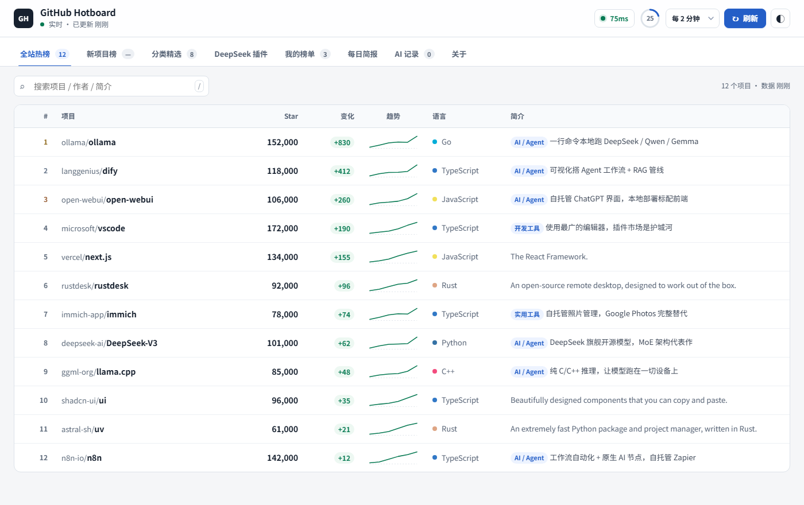
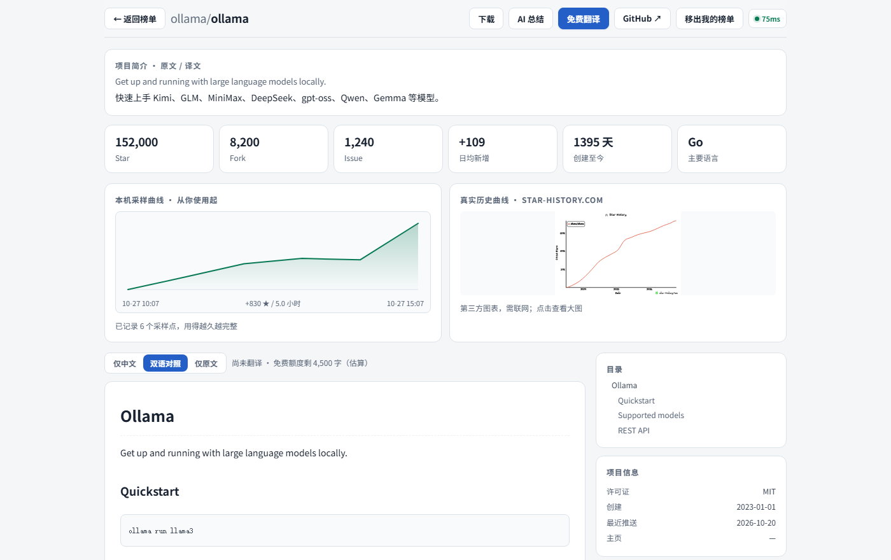
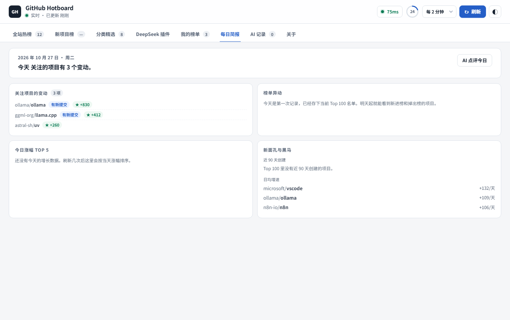
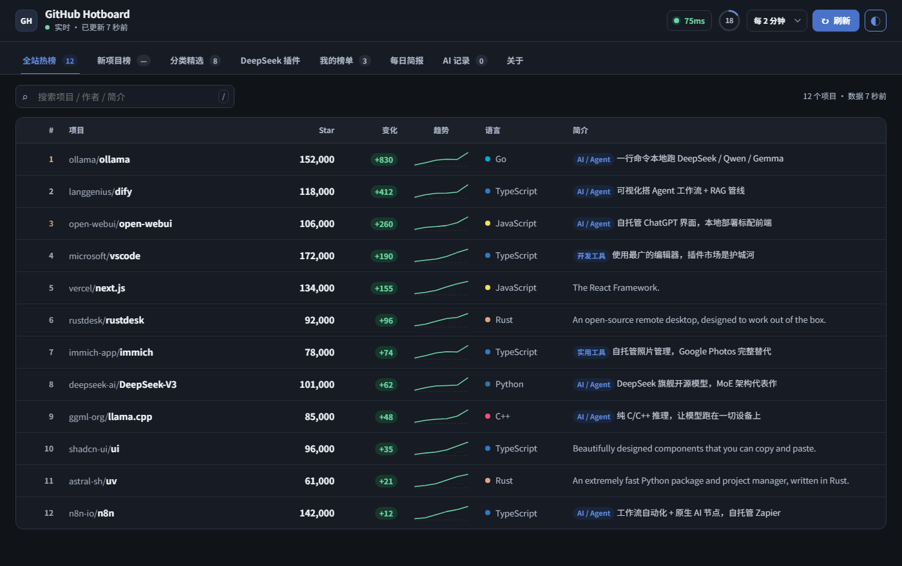

# GitHub Hotboard

**A local dashboard for GitHub trending — what to look at today, on one screen.**

[](https://github.com/Tiany-ii/github-hotboard/releases)
[](LICENSE)
[](#requirements)
[](#data-sources--privacy)



---

## What it is

GitHub Hotboard is a desktop dashboard that runs entirely on your machine. It pulls the
GitHub trending lists, tracks the repositories you care about, and lets you judge a project
without leaving the app — bilingual README, growth curve, and an AI summary that also weighs
stars, issues and maintenance activity.

**The problem it solves.** GitHub's own trending page gives you a list and nothing else. It
does not tell you how fast a project is growing, whether it is still maintained, or what it
actually does. Hotboard puts all of that on one screen and caches it locally, so the second
launch is instant.

**What it does not do.** No account, no recommendation algorithm, no uploading of your usage
data, and it never stars or forks anything on your behalf. Every request goes straight to
GitHub's public API.

---

## Screenshots

<details>
<summary>Repository detail — bilingual README, metrics, growth curve</summary>



</details>

<details>
<summary>Daily brief — one page per day, refreshed automatically</summary>



</details>

<details>
<summary>Dark theme</summary>



</details>

---

## Features

- **Five boards + a daily brief.** Trending, new projects, categories, the DeepSeek plugin
  ecosystem, and your own watchlist. The brief rolls the day up into one page and renews
  itself every morning.
- **Watchlist change alerts.** Star deltas, new commits, issue spikes, and "90 days without a
  push". Costs **zero extra API calls** — it diffs the data the watchlist already fetched.
- **Bilingual README.** Original / side-by-side / Chinese only. Aligned per block, not a
  whole-page machine translation.
- **AI summary card.** Besides the README, the model also sees stars, forks, open issues, last
  push and license — so it can say things like *"last commit 8 months ago with 1,200 open
  issues; maintenance may have stalled"*, which the README will never tell you.
- **One-click download.** Lists release assets and source ZIP with a plain-language
  explanation of the difference, asks where to save, shows progress, and unpacks source
  archives without overwriting existing folders.
- **Local first.** No account, no telemetry. Data lives in the WebView2 profile, or next to
  the exe in portable mode — copy the folder and your watchlist comes with it.
- **Bring your own model.** Store several DeepSeek keys and switch between them; choose
  `deepseek-flash` or `deepseek-v4-pro`, with a separate thinking-mode toggle.
- **Details that matter.** Light and dark themes, keyboard reachable (Tab to a row, Enter to
  open), and the last cached data stays visible when the network drops.

---

## Requirements

- **Windows 10 or later** (x64). macOS and Linux are not supported yet.
- **WebView2 Runtime** — preinstalled on Windows 11 and current Windows 10. If the window is
  blank, install it from [Microsoft](https://developer.microsoft.com/microsoft-edge/webview2/).
- No Python needed to run the prebuilt exe.

---

## Quick start

1. Download the latest `GitHub-Hotboard-*-win-x64.zip` from [Releases](../../releases) and extract it anywhere.
2. Run `GitHub Hotboard.exe`.

> **Windows SmartScreen** will warn you the first time ("Windows protected your PC") because
> the binary is not code-signed. Click **More info → Run anyway**. If you would rather not
> trust a binary, run it from source — see below.

**Portable mode.** Put a file named `portable.txt` (or a `data` folder) next to the exe, and
all settings, watchlists and caches are stored in `./data` instead of `%LOCALAPPDATA%`.

---

## Usage

A short tour lives in [`docs/使用说明.html`](docs/使用说明.html) (Chinese, opens in any
browser). The five things most people do:

| I want to… | Do this |
|---|---|
| See what is hot today | Open the app — the first tab loads automatically |
| Judge whether a project is worth a week | Click a row → read the AI summary card |
| Read the README in Chinese | Detail page → **翻译** (needs a DeepSeek key, or the free engine) |
| Track a project | Detail page → **加入我的榜单** |
| Download a release or source | Detail page → **下载** |

Optional: add a DeepSeek API key in **关于** (About) to enable AI summaries and higher-quality
translation. Without a key the app falls back to a free translation service with a small daily
quota.

---

## Data sources & privacy

Everything runs locally. There is no backend, no analytics and no crash reporting.

| Service | Used for | Notes |
|---|---|---|
| `api.github.com` | All repository data | Public REST API; unauthenticated limit is 60 req/h, 5,000 with a token |
| `codeload.github.com` | Source ZIP download | Only when you click download |
| `api.deepseek.com` | AI summary, translation | Only if you add your own key |
| `api.mymemory.translated.net` | Free translation fallback | Anonymous limit ≈ 5,000 chars/day per IP |
| `api.star-history.com` | Third-party growth chart image | Rendered as an image; the app works without it |
| `awesome-dsh-plugin.com` | DeepSeek plugin catalog | Third-party JSON; the app degrades gracefully if it is down |

**What is stored locally:** watchlist, translation and summary caches, download history, and
API keys if you add them. All of it lives in the WebView2 profile (`%LOCALAPPDATA%\GitHubHot`
or `./data` in portable mode) and never leaves your machine except as the API requests above.

**Keys are never exported.** Backup files intentionally omit the DeepSeek key and the GitHub
token.

---

## Run from source

```bash
git clone https://github.com/Tiany-ii/github-hotboard.git
cd github-hotboard
python -m pip install -r requirements.txt
python app.py
```

You can also open `github-hot.html` directly in a browser — everything works except the
download button (it degrades to a normal browser download) and the native folder picker.

Useful flags:

```bash
python app.py --version      # print version
python app.py --where        # print where data is stored
python app.py --selftest     # headless check: server + page load
python app.py --selftest-dl  # headless check: download + unzip
python app.py --reset        # rename a broken WebView2 profile (keeps your data)
python app.py --debug        # open devtools
```

---

## Build

```bash
python -m pip install -r requirements.txt
python build.py            # or double-click build.bat
```

The artifact lands in `dist/GitHub Hotboard.exe` (~13 MB, single file).

> The WebView2 .NET assemblies must be placed at the **root** of the PyInstaller archive,
> otherwise the window renders blank. `build.py` already handles this — do not remove those
> `--add-binary` lines.

---

## Project structure

```
github-hotboard/
├─ app.py              # desktop shell: local HTTP server, window, downloader, CLI flags
├─ github-hot.html     # the entire UI: HTML + CSS + JS in one file, no build step
├─ build.py            # PyInstaller packaging
├─ build.bat           # Windows one-click wrapper for build.py
├─ app.ico
├─ requirements.txt
├─ docs/
│  ├─ 使用说明.html     # user guide (Chinese)
│  ├─ 更新记录.txt      # detailed change log (Chinese, every commit)
│  ├─ CHANGELOG.md     # release-level summary (Keep a Changelog)
│  └─ images/          # screenshots used in this README
└─ LICENSE
```

The UI is deliberately a single file with zero dependencies: change a style, hit refresh, see
the result. The trade-off is size — see below.

---

## Known limitations

- **Windows only.** The shell relies on WebView2, `os.startfile` and `%LOCALAPPDATA%`.
- **The UI is one 200 KB HTML file.** No bundler, no modules, no tree shaking. It keeps
  contribution friction near zero but makes large refactors harder.
- **No automated tests or CI.** Verification is currently manual plus the `--selftest*` flags.
- **No auto-update.** Download the new release manually.
- **Unsigned binary.** Expect a SmartScreen prompt on first run.
- **GitHub API limits apply.** Unauthenticated requests are capped at 60 per hour; add a token
  in the app to raise it to 5,000.

---

## License

[MIT](LICENSE).

This is an unofficial project. It is not affiliated with, endorsed by, or sponsored by
GitHub, Inc. "GitHub" is a registered trademark of GitHub, Inc.

---

## Credits

- [star-history.com](https://star-history.com) — growth chart images
- [awesome-dsh-plugin.com](https://awesome-dsh-plugin.com) — DeepSeek plugin catalog
- [MyMemory](https://mymemory.translated.net) — free translation fallback
- [DeepSeek](https://platform.deepseek.com) — AI summary and translation
- [pywebview](https://pywebview.flowrl.com) — desktop shell
